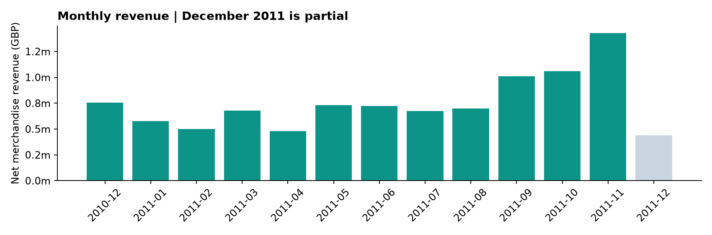

# E-commerce Revenue and Customer Analysis

An independent SQL-first business analytics case study by Minwoo Jeong.
Analyze revenue quality, customer concentration, and observed repeat purchasing
at a UK online retailer; turn findings into a focused investigation plan.

**[Interactive dashboard](dashboard/index.html)** (download and open locally) ·
**[Five-page executive brief](reports/executive_brief.pdf)** ·
**[SQL queries](sql/)** · **[Methodology](docs/methodology.md)**



## Business questions

1. Which countries and periods drive merchandise revenue?
2. Which products warrant a cancellation investigation, and are outliers driving it?
3. How concentrated is identified-customer revenue, and how do purchase cohorts recur?
4. Under explicit assumptions, how sensitive is potential contribution to cancellation avoidance?

## Measured findings

| Metric | Result |
|---|---:|
| Original transaction lines | 541,909 |
| Exact duplicate lines excluded | 5,268 |
| Merchandise gross sales | GBP 10,229,905 |
| Cancellation adjustments | GBP 475,249 |
| Net merchandise revenue | GBP 9,754,656 |
| Merchandise sales invoices | 19,771 |
| Same-period cancellation-value ratio | 4.65% |
| Ratio excluding absolute line quantities > 10,000 | 2.30% |
| Repeat buyers / identified buyers | 65.3% |
| Repeat-buyer share of identified gross sales | 92.8% |
| Top-decile share of identified gross sales | 61.4% |

The outlier sensitivity is central: validate large transaction/cancellation
pairs before assuming their value is recoverable. Use product-level review and
a controlled service-led retention pilot instead of inferring a causal fix.
No intervention was deployed and no savings are claimed.

## What is built

- Eight readable SQLite scripts: canonical model, KPIs, country/month revenue,
  product priorities, repeat-customer concentration, cohort retention, scenario
  sensitivity, and extreme-quantity robustness.
- Python ingestion of the original workbook, integer-pence monetary calculations,
  exact duplicate tracking, quarantine logging, and 12 validation checks.
- A self-contained dashboard with country and month filters, monthly charts,
  an all-period product queue, a cohort heatmap, and assumption sliders. No login,
  server, tracking, external scripts, or API keys are required.
- Aggregate CSV/JSON extracts, PNG charts, a five-page PDF management brief,
  methodology, source attribution, and unit tests for edge cases.

## Reproduce

Python 3.10+; SQLite window-function support is included in modern Python.

```bash
python -m venv .venv
# Activate the environment, then:
pip install -r requirements.txt
python src/pipeline.py --download
python -m unittest discover -s tests -v
```

Open `dashboard/index.html` in a browser. The generated HTML embeds aggregate
data, so it works offline without CORS or package setup. To inspect queries:

```python
import sqlite3
from pathlib import Path
con = sqlite3.connect('data/warehouse.sqlite')
print(con.execute(Path('sql/02_kpis.sql').read_text()).fetchall())
```

`--download-only` fetches the original archive without running the model.
Once the raw workbook exists, `python src/pipeline.py` rebuilds offline.
The pipeline recreates only its generated local warehouse and report files.

## Definitions and limitations

- Gross and net values concern the documented merchandise-code scope, not total
  company revenue. Non-product codes and ambiguous sign patterns are counted and
  excluded; see `reports/data_quality.json`.
- C-prefixed invoices identify cancellation adjustments. They are not verified
  physical returns or matched original-order return rates.
- Costs and discount fields are unavailable. Contribution sliders are explicitly
  hypothetical and exclude intervention costs; they are not a profit estimate.
- December 2011 is partial. Cohorts are first observed purchases, with left
  censoring and unequal follow-up. Unobserved cells remain blank.
- Anonymous sales stay in financial totals but are excluded from customer views.
  Customer and product panels use the full period and are labeled accordingly.
- Outliers remain in the primary analysis and are shown separately, not silently
  discarded. Duplicate exclusion is a convention; an alternate total is logged.

## Repository map

```text
src/            Ingestion, validation and presentation
sql/            Auditable analytical queries
dashboard/      Source template and generated offline dashboard
reports/        Aggregate extracts, quality checks, charts and PDF brief
docs/           Analytical choices and interpretation
tests/          Edge-case SQL and ingestion tests
data/           Attribution; downloaded raw files and warehouse are ignored
```

## Source and licensing

Chen, D. (2015). Online Retail [Dataset]. UCI Machine Learning Repository.
https://doi.org/10.24432/C5BW33 — CC BY 4.0. Source coverage is December 2010
through December 9, 2011. See [data provenance](data/README.md) for transformations
and the archive hash. Code is MIT-licensed; source and derived aggregate data
retain CC BY 4.0 attribution. Built with AI assistance; all reported figures are
computed from the source through the committed SQL pipeline.

## Resume description

Built a reproducible SQL analytics pipeline on 541,909 retail transaction lines,
with 12 reconciliation checks, an interactive dashboard and an executive
brief examining cancellation outliers, revenue concentration and customer cohorts.
